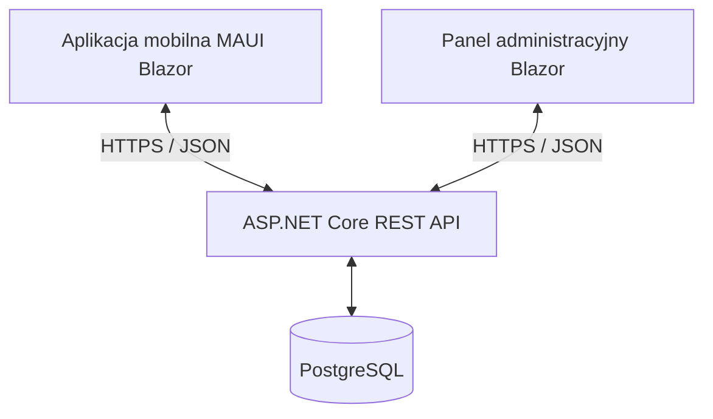

# Usterki - System zgłaszania i obsługi usterek w budynkach mieszkalnych wspomagający właścicieli i lokatorów.

Projekt realizowany w ramach pracy inżynierskiej:

Projekt i implementacja aplikacji mobilnej i panelu administracyjnego do zgłaszania i obsługi usterek w budynkach.

Design and implementation of a mobile application and an administrative panel for reporting and managing faults in buildings.

> Projekt w trakcie implementacji backendu (około 80% gotowe).
> Następny etap implementacji - aplikacja mobilna

## Cel projektu
Celem jest zaprojektowanie i implementacja aplikacji mobilnej i panelu administracyjnego wspierających oraz upraszczających proces zgłaszania i obsługi usterek występujących w budynkach.

Grupą docelową są właściciele mieszkań oraz zarządcy
budynków i wspólnot mieszkaniowych.

Aplikacja ma zapewnić jedno miejsce do:
- zgłaszania usterek wraz ze zdjęciami i lokalizacją,
- komunikacji dotyczącej konkretnego zgłoszenia,
- przydzielania osób odpowiedzialnych za naprawę,
- śledzenia statusu i historii obsługi,
- przeglądania i eksportowania zgłoszeń.

## Stan realizacji
Zadania do realizacji:
- Przegląd istniejących rozwiązań informatycznych wspierających zgłaszanie i obsługę usterek w budynkach.
- Analiza wymagań funkcjonalnych i jakościowych rozwiązania.
- Projekt architektury rozwiązania oraz modelu danych w bazie PostgreSQL.
- Implementacja warstwy serwerowej z interfejsem API REST, uwierzytelnianiem JWT i autoryzacją opartą na rolach użytkowników.
- Realizacja aplikacji mobilnej umożliwiającej zgłaszanie usterek z dodawaniem zdjęć oraz wyborem kategorii i lokalizacji.
- Implementacja panelu administracyjnego do przydziału zgłoszeń, zmiany statusów i filtrowania.
- Realizacja mechanizmów powiadomień, historii statusów oraz eksportu zgłoszeń do formatów CSV i PDF.
- Testy funkcjonalne oraz weryfikacja bezpieczeństwa rozwiązania.

- ### Implementacja backendu

- [x] Rejestracja i logowanie użytkowników.
- [x] Uwierzytelnianie JWT z tokenami dostępu i odświeżania.
- [x] Odświeżanie tokenów i wylogowanie.
- [x] Autoryzacja oparta na rolach.
- [x] Kontrola dostępu do zasobów i izolacja danych organizacji.
- [x] Obsługa organizacji, lokali i zaproszeń.
- [x] Tworzenie i pobieranie zgłoszeń.
- [x] Obsługa komentarzy.
- [x] Zmiany statusów i historia zmian.
- [x] Wersjonowanie zgłoszeń i kontrola konfliktów aktualizacji.
- [x] Paginacja list.
- [x] Dokumentacja API w formacie OpenAPI.
- [x] Testy integracyjne backendu.
- [x] Przydzielanie serwisantów do zgłoszeń.
- [ ] Przesyłanie zdjęć i bezpieczny dostęp do załączników.
- [ ] Aplikacja mobilna .NET MAUI Blazor Hybrid.
- [ ] Wykonywanie zdjęć natywnym aparatem telefonu.
- [ ] Panel administracyjny w Blazor.
- [ ] Rozbudowane filtrowanie zgłoszeń.
- [ ] Powiadomienia push.
- [ ] Eksport zgłoszeń do CSV i PDF.
- [ ] Rozszerzenie testów bezpieczeństwa i testów klientów.
- [ ] Dokumentacja wdrożenia.

## Technologie

| Obszar | Technologie |
|---|---|
| Język i platforma | C#, .NET 10 |
| Backend | ASP.NET Core Web API |
| Aplikacja mobilna | .NET MAUI Blazor Hybrid |
| Panel administracyjny | Blazor |
| Baza danych | PostgreSQL |
| Dostęp do danych | Entity Framework Core, Npgsql |
| Uwierzytelnianie | JWT, tokeny odświeżania |
| Autoryzacja | Role i kontrola dostępu do zasobów |
| Dokumentacja API | OpenAPI |
| Narzędzia | Visual Studio, pgAdmin 4, Postman, Git |

## Architektura

System składa się z trzech głównych komponentów:
1. REST API realizującego logikę biznesową i kontrolę dostępu.
2. Aplikacji mobilnej dla użytkowników zgłaszających usterki.
3. Panelu administracyjnego do zarządzania obsługą zgłoszeń.

Oba interfejsy użytkownika komunikują się z backendem przez HTTP/HTTPS.
Nie łączą się bezpośrednio z bazą danych.



### Podział rozwiązania

| Projekt | Odpowiedzialność |
|---|---|
| `Usterki.Api` | Endpointy REST, konfiguracja aplikacji, uwierzytelnianie i autoryzacja |
| `Usterki.Domain` | Encje i model domeny |
| `Usterki.Infrastructure` | Dostęp do PostgreSQL, konfiguracja EF Core i migracje |
| `Usterki.Contracts` | Kontrakty żądań i odpowiedzi API |
| `Usterki.Mobile` | Aplikacja mobilna .NET MAUI Blazor Hybrid |
| `Usterki.IntegrationTests` | Testy integracyjne backendu |

## Uruchomienie lokalne backendu

### Wymagania

- .NET SDK 10.
- Visual Studio z obsługą ASP.NET Core.
- Uruchomiony serwer PostgreSQL.
- Narzędzia Entity Framework Core zgodne z wersją pakietów projektu.
- Opcjonalnie pgAdmin 4 i Postman.

Do pracy nad aplikacją mobilną wymagane są również komponenty
.NET MAUI oraz narzędzia odpowiedniej platformy.

### 1. Pobranie projektu

Sklonuj repozytorium i otwórz rozwiązanie w Visual Studio.

Ustaw `Usterki.Api` jako projekt startowy.

### 2. Konfiguracja bazy danych

Skonfiguruj połączenie pod kluczem:

`ConnectionStrings:DefaultConnection`

Prezentacja konfiguracji:

```text
Host=localhost;Port=TWOJ_PORT(DEFAULT:5432);Database=usterki;Username=TWOJ_UZYTKOWNIK;Password=TWOJE_HASLO
```
### 3. Konfiguracja JWT

Uzupełnij ustawienia JWT wymagane przez aktualną konfigurację
projektu `Usterki.Api`, w tym klucz podpisujący tokeny.

### 4. Migracje bazy danych

W konsoli Menedżera pakietów NuGet w Visual Studio wykonaj:

```powershell
Update-Database -Project Usterki.Infrastructure -StartupProject Usterki.Api -Context AppDbContext -Args '--environment Development'
```

### 5. Uruchomienie API

Uruchom projekt `Usterki.Api` z profilem HTTPS.
Port będzie zawarty w konsoli po uruchomieniu

Adres:

```text
https://localhost:TWOJ_PORT
```

Dokument OpenAPI:

```text
https://localhost:TWOJ_PORT/openapi/v1.json
```
## Testowanie

Projekt zawiera testy integracyjne backendu które weryfikują:

- rejestracja, logowanie i obsługa tokenów,
- dostęp zależny od roli użytkownika,
- izolacja danych pomiędzy organizacjami,
- obsługa zgłoszeń i komentarzy,
- zmiany statusów oraz historia,
- konflikty aktualizacji zgłoszeń.

Testy można uruchomić w Eksploratorze testów Visual Studio.

Przed uruchomieniem należy przygotować środowisko wymagane przez konfigurację projektu testowego. 
Testy korzystające z bazy danych powinny używać osobnej bazy testowej. 
Postman wykorzystywany jest do sprawdzania endpointów ręcznie.

### Docelowy przebieg obsługi zgłoszenia

1. Mieszkaniec loguje się do aplikacji.
2. Wybiera lokal lub miejsce wystąpienia usterki.
3. Dodaje kategorię, opis oraz zdjęcie.
4. API sprawdza dane i uprawnienia, a następnie zapisuje zgłoszenie.
5. Właściciel lub zarządca analizuje zgłoszenie i przypisuje serwisanta.
6. Uczestnicy wymieniają komentarze.
7. Zmiany statusu trafiają do historii.
8. Użytkownik otrzymuje powiadomienie o postępie.
9. Zakończone zgłoszenie można uwzględnić w eksporcie CSV lub PDF.

## Autor 

Jakub Wilke 

Politechnika Bydgoska im. Jana i Jędrzeja Śniadeckich

